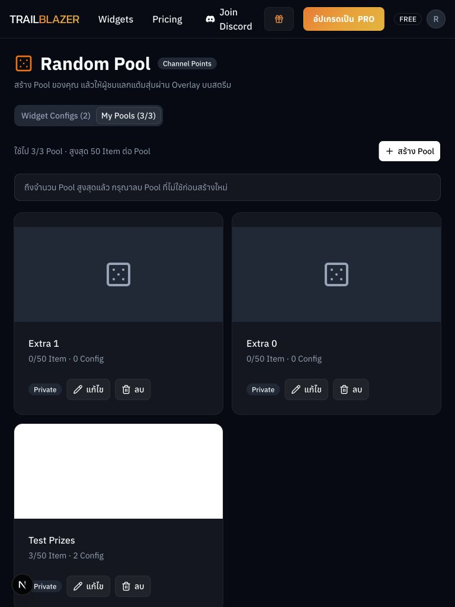

# TRAILBLAZER Frontend: UI component catalog

สำรวจจาก source code ณ 23 ตุลาคม 2026 ครอบคลุมไฟล์ `.tsx` ใน `components/`, `features/*/components/` และ `app/**/_components/` รวม **146 ไฟล์** (ไม่นับ `page.tsx`, hooks, API และ context ที่ไม่มี UI โดยตรง) ชื่อในรายการเป็นชื่อไฟล์ จึงอาจต่างจากชื่อ export ภายในเล็กน้อย

## ภาพอ้างอิงที่มีใน repository

ภาพด้านบนเป็น screenshot จริงที่มีอยู่ใน repository สำหรับ Random Pool ส่วนโลโก้และภาพประกอบอื่นดูได้ที่ [`public/`](../public/). Repository ยังไม่มี screenshot แยกสำหรับ component ทุกตัว จึงไม่แสดงภาพจำลองเป็นหน้าตาจริง

## Design foundation

| หัวข้อ | ค่าที่ใช้จริง / ข้อสังเกต |
| --- | --- |
| Framework | Next.js 16, React 19, Tailwind CSS 4, shadcn/ui และ Radix/Base UI |
| ธีมเริ่มต้น | `dark` ถูกกำหนดบน `<html>` ใน `app/layout.tsx` |
| พื้นหลัง / การ์ด | `#070a14` / `#131720`; popover `#121212` |
| สีหลัก / เน้น | `#FF8C00` / `#FFD700`; gradient `#F97316 → #F59E0B → #EAB308` |
| ตัวอักษร | Anuphan เป็น sans หลัก; Kanit เป็น font เสริม |
| มุมโค้ง | radius token ฐาน `0.625rem` (10px); card ใช้ `rounded-xl` |
| สถานะ | muted text `#94a3b8`, destructive ใช้ token แดง; Twitch `#6441a5`, Discord `#5865F2`, Spotify `#1ED760` |
| กฎในโปรเจกต์ | ใช้ shadcn ก่อนสร้าง custom; ขนาดตัวอักษรต่ำสุด `text-sm`; input ไม่ใช้สี CI `#FF8C00` |

> `palette.md` เป็นแนวคิดสีหลายทาง ไม่ใช่ source of truth ของธีมที่รันจริง; ดู `app/globals.css` สำหรับ token ปัจจุบัน

## Primitive UI (`components/ui/`) — 30 ไฟล์

| Component | บทบาทและลักษณะดีไซน์ |
| --- | --- |
| Accordion | เปิด/ปิดเนื้อหาเป็นส่วน ๆ |
| AlertDialog | ยืนยันการกระทำสำคัญหรือเสี่ยง |
| Alert | ข้อความสถานะ/แจ้งเตือนในหน้า |
| Avatar | รูปประจำตัวและ fallback |
| Badge | ป้ายสถานะขนาดเล็ก |
| Button | ปุ่มหลัก; variants: default, outline, secondary, ghost, destructive, link, twitch; sizes: xs, sm, default, lg และ icon |
| Card | กล่องพื้น `bg-card`, ring บาง, มุม `rounded-xl`, shadow เบา; มี Header/Title/Description/Content/Footer |
| Checkbox | เลือกแบบหลายค่า |
| Combobox | ค้นหาและเลือกตัวเลือก |
| Dialog | modal ทั่วไป |
| DropdownMenu | เมนูคำสั่งตามบริบท |
| Field | โครงสร้าง label/control/error ของฟอร์ม |
| InputGroup | input พร้อมส่วนประกอบด้านข้าง |
| Input | ช่องข้อความทั่วไป |
| Label | ชื่อ field ที่ผูกกับ control |
| Popover | แผงลอยสำหรับข้อมูลหรือ control |
| Progress | แถบแสดงความคืบหน้า |
| RadioGroup | เลือกค่าเดียวจากชุดตัวเลือก |
| ScrollArea | พื้นที่เลื่อนแบบกำหนดเอง |
| Select | เลือกรายการแบบ dropdown |
| Separator | เส้นแบ่งเนื้อหา |
| Sheet | แผงเลื่อนจากขอบหน้าจอ |
| Skeleton | placeholder ระหว่างโหลด |
| Slider | เลือกค่าต่อเนื่อง |
| Sonner | toast notification |
| Switch | เปิด/ปิดสถานะ |
| Table | ตารางข้อมูล |
| Tabs | สลับชุดเนื้อหา |
| Textarea | ข้อความหลายบรรทัด |
| Tooltip | คำอธิบายสั้นเมื่อ hover/focus |

ไฟล์จริงทั้งหมดอยู่ใน [`components/ui/`](../components/ui/). Primitive เป็นฐานที่ feature ต่าง ๆ นำไปประกอบและปรับ `className` เพิ่ม

## Shared application components

| กลุ่ม | Components | การใช้และลักษณะเด่น |
| --- | --- | --- |
| Navigation / shell | `navbar`, `conditional-footer`, `floating-support`, `brand-logo` | Navbar สูง `h-16`, โปร่งแสงพร้อม backdrop blur, desktop navigation และ mobile dropdown; footer แสดงตาม route |
| Landing | `landing/hero`, `landing/features`, `landing/streamer-showcase`, `landing/footer`, `fancy/light-pillar` | ส่วนการตลาด ใช้ gradient, typography ใหญ่ และเอฟเฟกต์แสง |
| Account / access | `referral-dialog`, `referral-tracker`, `tier-guard` | referral และการจำกัดสิทธิ์ตาม tier; tracker/guard เป็น behavior มากกว่า visual |
| Actions | `button/DeleteWidgetButton`, `SaveWidgetButton`, `TestWidgetButton`, `TwitchLoginButton` | ปุ่มเฉพาะ action พร้อม icon, loading/disabled และโทนตามความหมาย |
| Feedback | `dialog/UpgradeToProPlanDialog`, `MultiStepProgressBar`, `SubLabel`, `TrailblazerAccordian/*` | upgrade modal, ลำดับขั้น และรายละเอียดแบบยุบ/ขยาย |
| Brand icons | `icons/discord`, `spotify`, `twitch`, `youtube` | SVG/icon สีตามแพลตฟอร์ม |
| Demo / supporting | `component-example`, `example`, `user-context` | ตัวอย่างและ context; `user-context` ไม่มี UI โดยตรง |

## Widget configuration components

| กลุ่ม | Components | รายละเอียดด้านดีไซน์ |
| --- | --- | --- |
| Media | `AudioFileUploader/*` (3), `SmartAudioFileUploader` | ช่องอัปโหลดเสียงแบบเต็ม, dialog และแบบ compact; ใช้ในฟอร์ม widget |
| Integrations | `BotProfileSelector`, `ChannelRewardSelector`, `TwitchRewardSelector` | ตัวเลือกที่ผูกข้อมูล Twitch/bot |
| Overlay | `OverlayUrlInput`, `SmartOverlayUrlInput`, `OBSSetupHelp` | แสดง URL overlay และคำแนะนำ OBS, เน้น copy/นำไปใช้งาน |
| Settings | `MSDelaySlider`, `ReplyMessageHelp`, `CharacterCountTextarea`, `QuotaMeter` | slider เวลา, input ข้อความตอบ และแสดง quota |
| Status / testing | `WidgetEnabledBadge`, `WidgetQuotaDialog`, `WidgetStatusControl`, `WidgetStatusSwitch`, `WidgetTestControl`, `WidgetTypeLoadError` | สถานะเปิดใช้งาน, quota, ทดสอบ และข้อผิดพลาด |
| Layout / stepper | `layout/WidgetConfigLayout`, `WidgetStepper/*` (4) | โครงหน้า config และขั้นตอนการตั้งค่า |
| Tab cards | `widget-tab-card/WidgetOverviewCard`, `WidgetQuickStartCard`, `WidgetSettingsCard/*` (3) | การ์ด Overview / Quick Start / Settings และส่วน Content/Footer |

## Workflow builder

| Component | บทบาท |
| --- | --- |
| `NodeConfigurationModal` | แก้ค่า node ใน modal |
| `nodes/NodeWrapper` | กรอบร่วมของ node |
| `nodes/TriggerNode` | จุดเริ่ม workflow |
| `nodes/ConditionNode` | เงื่อนไขแยกเส้นทาง |
| `nodes/ActionNode` | คำสั่งปลายทาง |

ใช้ `@xyflow/react` จึงมี interaction แบบ canvas, node และ connection; ไม่ใช่ primitive ของฟอร์มทั่วไป

## Feature components

| Feature | Components | ภาพรวม UI |
| --- | --- | --- |
| Account binding | `AccountBindingPage`, `PlatformCard` | หน้าเชื่อมบัญชีและการ์ดแพลตฟอร์ม |
| Clip shoutout | `ClipShoutoutWidget` | ตั้งค่า widget เล่นคลิป |
| Drop image | `DropImageWidget` | ตั้งค่า overlay รูปภาพ |
| End credit | `CreditRow`, `CreditValueBadge`, `EndCreditWidget` | แถว/ค่าของเครดิตและหน้าตั้งค่า |
| Export video | `ExportVideoHistoryList`, `ExportVideoWidget`, `YouTubePrivacySelect` | ตั้งค่าส่งออก, รายการย้อนหลัง, privacy ของ YouTube |
| First word | `CustomReplyList`, `FirstWordWidget` | รายการคำตอบและหน้าตั้งค่า |
| Random DBD killer | `AnimationStyleSelect`, `KillerPoolSelector`, `RandomDBDKillerWidget` | เลือก animation/pool และตั้งค่า |
| Random DBD perk | `MaxPerkSelector`, `PerkConfigItem`, `RandomDbdPerkWidget`, `RandomFormatInfo` | จำนวน perk, รายการ config, คำอธิบายรูปแบบ |
| Spotify song request | `SpotifySongRequestWidget` | ตั้งค่าคำขอเพลง |
| Uploaded files | `UploadedFileManager` | จัดการไฟล์อัปโหลด |
| Widget gallery | `WidgetCard`, `WidgetGallery` | การ์ดรายการ widget บน dashboard |
| Pricing | `PricingClient`, `PricingTwitchDialog`, `SelectPlanButton` | ราคา, dialog เชื่อม Twitch และเลือกแผน |

### Random Pool (26 components)

| งาน | Components |
| --- | --- |
| Navigation / overview | `RandomPoolPage`, `OverviewTab`, `QuickStartTab`, `SettingsTab`, `ConfigSwitcher`, `SectionTitle`, `Callout` |
| Pool / item management | `PoolCreateForm`, `PoolItemsEditor`, `PoolItemsGrid`, `PoolPicker`, `ItemSheet`, `ItemThumb`, `OptionCard` |
| Config | `ConfigEditor`, `ConfigEnableSwitch`, `ConfigList`, `RandomPoolWidget` |
| Draw / preview / overlay | `DrawSection`, `PreviewPanel`, `RandomPoolOverlay`, `OverlayUrlField` |
| Reward / sound / message | `RewardLabel`, `RewardSelect`, `SoundField`, `ChatMessageField` |

> จำนวนที่พบจริงใน `features/random-pool/components/` คือ 26 ไฟล์; หัวข้อใช้การจัดตามหน้าที่เพื่อให้หาได้ง่าย

## Overlay UI แยกจาก component catalog

หน้าใน `app/overlays/` สำหรับ Clip Shoutout, Drop Image, End Credit, First Word, Random DBD Killer/Perk และ Random Pool เป็น **route** ที่ใช้แสดงผลบนสตรีมโดยตรง จึงไม่นับเป็น reusable component ข้างต้น `KillerFrameReveal` และ `KillerSpinner` เป็นชิ้น UI เฉพาะ route ของ Killer และใช้ animation/keyframes จาก `globals.css`

## ข้อสังเกตจากการตรวจดีไซน์

- `Button` default ใช้พื้นขาวตัวอักษรดำ ไม่ได้ใช้สีส้ม CI ทุกกรณี; สีส้มอยู่ที่ token `primary` และ class/gradient เฉพาะจุด
- `dark` เป็นค่าเริ่มต้นที่ hardcode ใน root layout แม้ `globals.css` จะมี light tokens
- มี `text-xs` ใน `Button` size `xs` และบาง feature ซึ่งขัดกับกฎ `text-sm` ขั้นต่ำใน `AGENT.md`; ควรตรวจแยกถ้าจะปรับมาตรฐานดีไซน์
- `FloatingSupport` ถูก import แต่ปิดการ render ด้วย comment ใน root layout
- ภาพ screenshot ที่มีอยู่ไม่ครอบคลุมทุก component; หากต้องการ visual audit ครบทุก state ควรสร้าง gallery/story สำหรับแต่ละ component และจับภาพจาก browser
